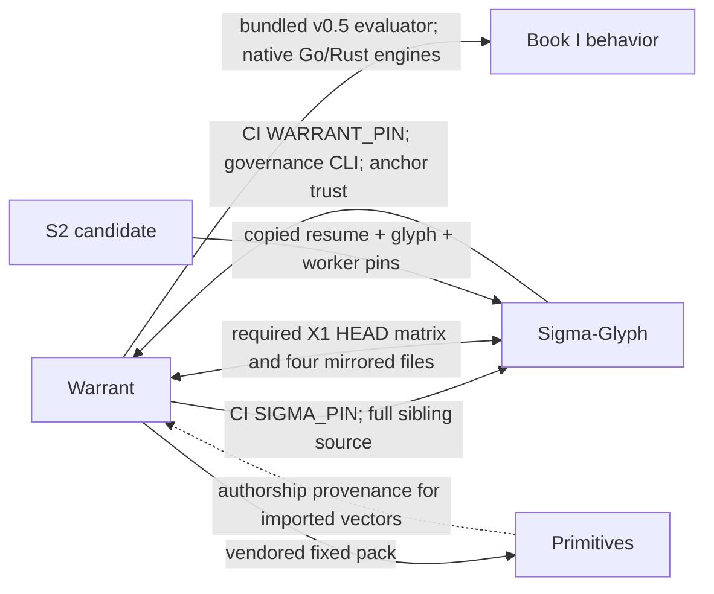
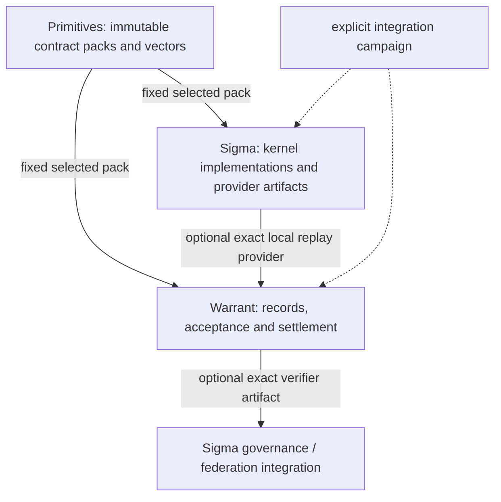

# WRT-024: Contract packs and provider artifacts instead of moving sibling checkouts

**Status:** DRAFT, local design proposal; no implementation, registration, release or governance adoption.
**Date / author:** 2026-10-18 / Codex, at the owner's request.
**Recommended direction:** use Primitives for portable behavioral contracts and conformance packs; let Sigma-Glyph supply an optional, complete replay provider artifact; keep Warrant responsible for acceptance and settlement. Replace mandatory HEAD-to-HEAD coupling with consumer-owned checks against immutable operands. Retain exploration across development heads as an advisory integration campaign.

WRT-023 is already used by the local `wrt-023/effects-gates` workline; this proposal uses WRT-024. Documents are reviewed locally by path and commit. No docs-only PR is requested.

## 1. Problem and intended result

Today a small runtime change can require inspecting two live repositories, interpreting several unrelated pins, synchronizing byte-identical CI scripts, preserving an old verifier checkout for Sigma governance, and copying executable Sigma modules into Warrant. An external Python dependency alone would remove only the copying. Moving those modules into Primitives would relocate the same runtime dependency and weaken the useful independence of existing implementations.

The intended boundary is stronger: a Warrant release can be built, tested and replayed without a Sigma **checkout**; a Sigma kernel can be built and tested without a Warrant **checkout**; Primitives can validate a contract pack without either checkout. A specific integration still names the exact implementation and acceptance policy it uses. There is no claim that computation or governance can operate without their semantic dependencies.

This is a proposal to reduce coordination, not to freeze Sigma's research or make Warrant merely a review application. Runtime substitution, reusable computation and closure protocols remain first-class uses. The operator permits breaking specifications while there are no external compatibility commitments. We should change an unnecessarily coupled active contract deliberately, rather than preserve accidental packaging forever; historical records must nevertheless retain their original meaning or become explicitly unsupported.

## 2. Exact research slice

| Symbol | Repository / revision | Role |
|---|---|---|
| W | warrant `de0fc912fdfb0bf519a1b0fefca137c13120e354` | fetched `origin/master`, S1 merged through #135 |
| S | sigma-glyph `c864d3ee01a2fe46c528bd6e9552438e64df5f6b` | fetched `origin/master`, #62 merged |
| P | primitives `040d1a777310c8819ad861d38f6fd7f9ef5beb48` | fetched `origin/main` |
| C1 | warrant `01a25e22a73565e5f86a5cb850c41650cf82c8bd` | unpublished initial S2 implementation |
| C2 | warrant `71514c04a3c96cc49633d8b239f9d82183dcb897` | unpublished S2 fixes; not merged or accepted here |

The [source index](wrt-024-evidence/SOURCE-INDEX.json) records 60 file digests, exact git-object locators and immutable GitHub links for the published source slices. C2 is marked local/unpublished; public availability is not asserted. [Observations](wrt-024-evidence/OBSERVATIONS.json) records mirror comparisons and packaging facts; the separate [protection readback](wrt-024-evidence/BRANCH-PROTECTION.json) records GitHub policy. Working branches and remote defaults are not substitutes for these revisions. Any successor to C2 needs its own affected-path review; this proposal does not assume that C2 is the final implementation.

### 2.1 Existing design work

W: `proposals/WRT-006-ski-v1-implementation-substitution.md` is CLOSED with disposition B: Book I v0.6 must not silently replace v0.5 under `ski@v1`. Its finite differential agreement is evidence, not universal equivalence.

W: `proposals/WRT-007-per-tag-evaluator-dependency.md` is CLOSED / DEFERRED. It already separated runtime semantics from release selection and measured an installed external evaluator. It failed at positive-credit activation/binding, and its reproducer is deliberately non-crediting. WRT-024 reuses the separation, not an assertion that that proposal was adopted. It does not revive the old registry/activation framework. Initial delivery uses a small release-owned selection manifest and existing recipient policy, with a fresh review of the actual positive path.

## 3. Current dependency graph

The provenance edge P → W is not a runtime import: `tools/import_warrant.py` reads a named git object when deliberately importing vectors. Ordinary pack validation does not fetch Warrant. That is the useful pattern to extend.

### 3.1 Warrant consumes Sigma in several different ways

1. **Normative runtime reference.** W `SPEC.md` §3.1/§13.1 binds `ski@v1` to Book I v0.5, and requires one evaluator per tag **per implementation**. A later Book I is a new tag. This is not a requirement that Python, Go and Rust share source bytes.
2. **Python execution.** `impl/warrant.py` / `trust/ski-runtime-evaluators.json` select bundled `impl/sigma_glyph_v05.py`. The recorded source is Sigma v0.6.7 / commit `16a13551…`, not today's Sigma HEAD. `impl/sigma_glyph_v06.py` is a reserved candidate; its presence does not register `ski@v2`.
3. **Independent implementations.** Warrant Go and Rust implement the evaluator themselves. Rust's `Cargo.toml` has no external crates. Python Warrant already depends on `cryptography>=41`; "zero dependencies" is not a property of the entire project or every integration.
4. **Pinned differential tests.** W `.github/workflows/ci.yml` and `wrt-005.yml` set `SIGMA_PIN=c5ab2ab218bbeaaf4d80d2e49be2cc7b48fb7f37`. They clone Sigma and explicitly use `WARRANT_SIGMA_DIFFERENTIAL=1` for non-crediting comparison. That pin is a test baseline, not the runtime's v0.5 source selection.
5. **Separate specimen copy.** `demos/redesign-refund/vendor/sigma/PIN.json` names `ad54abc8…`, a draft predecessor of merged #62. Its resume digest differs from S/C2. It is an experiment operand, not evidence that a current receipt was checked by the same kernel. Do not silently update a frozen experiment's baseline to make the labels agree.
6. **C2 replay integration.** `impl/replay.py`, `impl/replay_sigma_worker.py`, and `impl/sigma_resume_c864d3e/` copy two Sigma modules and maintain consumer-side component commitments. They are checkout-only: W's wheel module list does not ship `loops`, `triggers`, `replay` or the resume vendor directory.

### 3.2 Sigma consumes Warrant, but its kernel does not import Warrant

S `pyproject.toml` declares `dependencies=[]`, installing `sigma_glyph`, `sigma_wave`, `sigma_federation`. It **does not install `sigma_resume`**. Adding an installation extra cannot ship a missing module by itself; the artifact's payload must change.

`impl/sigma_federation.py` takes the accepted assertion set from its caller; its header explicitly leaves store/settlement I/O outside the oracle. The runtime package has no mandatory Warrant Python dependency. That separation should survive.

The coupling is in integration and governance: `.github/workflows/ci.yml` selects `WARRANT_PIN=0d147aa12158d18e686270fe4eca2972bd4707f1`; builds warrant-go as a fourth Book I engine; tests the machine-report connector; downloads a Warrant verifier and `trust/sigma-glyph-anchor-trust.json` for governance. `tools/test-all.sh` requires a caller-supplied `WARRANT` command and later derives the workflow's Warrant pin for network parity checks. A caller command and the pinned network verifier can therefore be different explicit operands within one broad matrix. Their results must be labelled separately, not counted as one implementation.

The CI comments explicitly say this historical Warrant pin predates `trust/ski-runtime-evaluators.json`; the evidence-view test currently exercises its missing-input path. A green job is not evidence that current runtime-registration interoperability was exercised.

Sigma already has `tools/candidate_artifact.py`, installed-artifact checks and a frozen candidate receipt. Reuse that delivery work. It does not yet make the new resume API part of the current wheel.

### 3.3 X1 is both semantic coverage and an organizational lock

Both repositories contain identical `tools/x1_cross_repo.sh`, `tools/x1_negative_control.sh`, `tools/book1_coverage.py` and `.github/workflows/x1-cross-repo.yml`. X1 requires their byte equality, including file presence. It runs on PRs, master pushes, daily schedule and explicit dispatch. A paired same-owner branch with the same name may substitute for sibling master; that is useful for joint experiments, but still coordinates branch names across repositories.

The matrix covers A1 full Book I class coverage, A2 differential fuzzing, B1 machine verification report, B2 Sigma's Warrant connector, C1 refusal of implicit unpinned substitution, C2 explicit non-crediting differential, C3 Warrant Go's own conformance, D1 anchor-trust/roster agreement, D2 Sigma anchors, and E the mirrored gate itself. These are different contracts; "remove X1" without replacements would remove useful checks.

GitHub protection readback on 2026-10-18: Warrant requires `test` and `cross-repo` (strict=false); Sigma requires `test`, `lean`, `SonarCloud Code Analysis`, `GitGuardian Security Checks`, `cross-repo` (strict=true). These are server-side requirements, not inferred from YAML. This proposal changes none of them.

## 4. Pin ledger: retain identity, reduce synchronization

| Pin / commitment now | What it actually establishes | Disposition |
|---|---|---|
| W `SIGMA_PIN` in two workflows | reproducible sibling test operand | replace ordinary PR clones with fixed contract pack + selected provider artifact; keep exact git commit for explicit source-comparison campaigns |
| S `WARRANT_PIN` | verifier/fuzzer/connector baseline, currently an old source checkout | replace with a complete selected Warrant artifact for governance/connector jobs; third-engine campaign separate |
| W v0.5 runtime module SHA `80299d68…` | selected Python implementation bytes | keep while that implementation is active; later generate from provider manifest, or make old support an explicit optional history profile |
| W runtime record + duplicated Python constant | consistency between declared selection and loader | one generated selection input plus a check of generated constants if embedding is needed; never two manually edited authorities |
| C2 resume `575a198d…`, glyph `f4d9990d…`, worker `db6d9243…` | complete local code boundary when bound to actual execution | one provider artifact closure; internal file manifest generated by provider; Warrant selects artifact digest |
| W demo resume `9bb1a17a…` | a different frozen experimental baseline | preserve as labelled specimen or retire deliberately after references are accounted for; not the active provider |
| W → P commit `040d1a77…`, manifest `d73bb63d…` | exact vendored behavior pack | retain fixed pack; evolve to class/contract-scoped selection so unrelated vectors do not force all consumers forward |
| P vector source commit/hash | authorship and reproducibility of an import | preserve provenance; do not resolve live source repositories during ordinary validation |
| S specification anchors and adoption records | exact document commitments plus governance acceptance | preserve; pack export references these where applicable, does not manufacture new adoption |
| S out-of-band anchor trust from W repository | receiver-selected trust root distribution | keep receiver-controlled; deliver in an explicit policy bundle selected out-of-band, independent of kernel provider/version |
| Python/Lean/Go/Rust build versions, GitHub action SHAs | tool/build/publish environment identities | retain by purpose; these are not the sibling-coupling problem |

Sigma's `FULL_PINS` wave vocabulary is a different meaning of "pin" from artifact integrity; do not collapse mathematical annotations, trust roots, dependency locks and source digests into one registry.

A package version is a locator/label; its artifact digest identifies delivered bytes. A contract ID names semantics, not a release date. Git commits provide source provenance, not proof of which files executed. A manifest's own digest must be selected by the consumer; checking a producer's self-consistent manifest alone grants nothing.

## 5. Recommended ownership and contracts

### 5.1 Primitives holds portable behavior, not a universal engine

Extend its existing catalog/run/probe/import pattern. Initial class names below are illustrative until their schemas are reviewed:

- `booki-v05-eval`: existing admitted `ski@v1` behavior, with exact scope and observables.
- `booki-v06-eval`: the distinct Book I 0.6 behavior; it is not automatically admitted in Warrant merely because the class exists.
- `resume-state`: canonical state/checkpoint encoding, identity, paid materialization and decoding refusal boundaries.
- `resume-replay`: root/environment binding, transition/reachability accounting, terminal outcome versus verified PREFIX and local inability to assess.

Start with the classes actually required by S2. Do not copy Books II/III, Lean, governance policies, loops, authority grants or S2 recipient decisions into a giant primitive. If source definitions cannot yet be made portable, import the exact bounded draft with its draft status; do not call a research API normative by moving its files.

Each contract pack needs: a closed input/output schema; the semantic definition or exact source-document commitment and attribution; an explicit admitted domain; expected observable values and refusal classes; vectors with stable IDs and provenance; its pack manifest; and controls showing the relevant negatives fail. Preserve source bytes/anchors and provenance when exporting. Transferring normative ownership to Primitives would be a distinct specification decision; initially it is an independently consumable export, not a silent transfer of Sigma authority.

Separate semantic identity from test-corpus identity: adding a counterexample may improve a corpus without changing the mathematical contract. Record both hashes. A change in reduction order, cost, encoding or meaning of an outcome changes the contract, even if existing vectors still agree. Finite conformance neither proves equivalence nor independently establishes governance authority.

Existing P `run.py` uses `warrant-conformance/1`; reuse its transport initially. Do not make a new runtime protocol merely to remove the word Warrant. Add strict response/class/request binding and complete expected output comparison where new classes require it. Local refusal/timeout is UNRUN or typed unassessed, never PASS.

### 5.2 Sigma owns the implementation artifact

Build a complete, namespaced resume provider containing the worker/entrypoint and required modules (or an equivalent standalone executable), a generated content manifest, supported contract IDs and source provenance. Avoid requiring callers to know `impl/sigma_resume_c864d3e/`, internal imports or a sibling directory. Preserve the existing candidate builder's clean-install and reproducibility checks; extend the actual payload and installed tests for resume.

One provider artifact can claim several contracts, but each supported contract is tested explicitly. v0.5 and v0.6 engines cannot both masquerade as the same flat `sigma_glyph` import. Use separate process environments/artifacts or versioned namespaces for coexistence. A Warrant optional extra may install a selected provider, but does not decide which semantics the receiver accepts, and must not resolve an arbitrary latest version at replay time.

Provider content hashes cover its executable closure and declared dependencies, not an endlessly recursive hash of all macOS/Python/CPU state. Record relevant host/runtime versions and admission limits separately. Deterministic contract results and host inability to run remain distinct. Additional dependencies need an explicit lock/artifact closure; the current Sigma reference being stdlib-only makes the initial closure small.

### 5.3 Warrant owns selection, execution and credit

The core validates records, signatures, authority/acceptance and the named computation. It consumes an explicit provider result; it does not infer acceptance from successful process execution or a producer's `target_profile` string. Keep C2's recipient-owned `crossing_targets` boundary until a reviewed successor replaces it.

Use one small release-owned selection record per delivery target: contract ID, selected provider/artifact digest, entrypoint, transport schema and supported local admission. Reuse existing trust/selection files where possible. If a Rust binary embeds an implementation, its release manifest identifies that implementation/build and the same semantic contract. This is not a new global registry, consensus service or activation protocol.

A successful provider run means locally recomputed evidence from an accepted implementation, not a mathematical proof that the implementation is universally correct. Keep the result bound to input/environment/expected answer, runtime/contract, verifier artifact, recipient profile, store view and limits that affect assessment. Never infer TRUE from a compiled check's `pass`; C1's X05 already demonstrated why.

**Execution identity is part of the boundary.** S2-04 at C2 showed that hashing a worker and later reopening its mutable path can execute different bytes under the old assessment identity. Select an admitted artifact, materialize/verify a private execution closure, and execute that closure. Construct the observed verifier identity from that same capture or a typed refusal. Do not import unverified cached bytecode or sibling modules. External packaging changes who maintains the manifest; it does not by itself solve this time boundary.

The existing isolated worker is a namespace boundary, not an OS sandbox. A received crossing never chooses an arbitrary command, executable download or network installation. Only the receiver's already selected local provider may run. The receipt still supplies data, not authority to execute scripts.

### 5.4 Keep Rust zero-crate core; make reference replay optional

No architecture need forces Warrant Rust to import Sigma or Primitives at runtime. It may keep its independent engine and consume the same data-only test pack. Python Warrant already has a cryptography dependency; Python optional replay may depend on the packaged provider. Sigma's kernel keeps no Warrant runtime dependency. Its optional governance tools use a Warrant verifier artifact.

If keeping multiple native engines stops paying for itself, that is a separate measured implementation decision, not an implication of Primitives. Agreement among implementations sharing the same engine does not count as independent-engine evidence.

## 6. CI replacement: coverage follows the contract, not sibling HEAD

| Existing X1 surface | Replacement required before removing its mandatory role |
|---|---|
| A1 Book I exact class coverage | fixed Primitives class pack against each claimed implementation; no skipped class counted as success |
| A2 differential fuzz | deterministic contract-level properties in owning repos; larger cross-provider differential as explicit integration campaign with recorded artifacts/seeds |
| B1 verification-report machine boundary | Warrant producer tests and Sigma connector consumer tests against fixed report fixtures plus a selected real installed Warrant artifact |
| B2 settlement connector | Sigma integration test with explicit CLI artifact + independent receiver policy bundle; invalid exits/stderr/schema/grade retain negative controls |
| C1 implicit unpinned substitution refusal | Warrant provider selection/integrity and no-fallback tests |
| C2 explicit differential | advisory/manual comparison; permanently non-crediting |
| C3 Go's own conformance | Warrant's own local CI, with no Sigma clone |
| D1 roster/trust relation | explicitly selected policy-bundle compatibility test; a live source roster cannot silently redefine receiver trust |
| D2 Sigma anchors | Sigma's local anchor/governance tests; external verifier needed only in the named governance integration lane |
| E byte-identical workflow/scripts | retire after replacement; test each consumer's adapter against shared vectors, not shared shell bytes |

Each ordinary PR gate runs only its selected artifacts/pack. A new Sigma commit, Warrant commit or Primitives HEAD cannot change a different repository's verdict until that consumer deliberately updates its selection. That is reproducibility, not blindness: scheduled/manual integration reports compare latest candidates separately and open a bounded upgrade task on a new incompatibility.

The advisory campaign must report actual artifact/source IDs, attempted contracts, executed counts, unsupported/refused states and comparisons to expected values. "Not run" is not a pass. Removing redundant required HEAD comparisons does not remove the previously discovered negative controls; their owners move with the relevant boundary.

**Trust distribution:** the policy bundle remains receiver-selected and separately pinned. It may still be published from Warrant or an independently chosen artifact location; location is not authority. Do not move keys into Primitives to make the dependency diagram look acyclic. Never derive the trusted quorum solely from the Sigma tree being verified.

## 7. Order of implementation and stopping conditions

| Step | Local owner / change | Completion evidence |
|---|---|---|
| M0: record boundaries | Warrant: this WRT; exact source/pin ledger and replacement map | review of the actual contracts; no runtime or protection changed |
| M1: export minimal contracts | Sigma authors exact behavior; Primitives publishes/reuses data pack classes and negative controls | pack validates without source checkouts; conformance with named expectations; statuses/domain and authorship preserved |
| M2: complete provider artifact | Sigma adds resume payload/API and generated closure manifest using its existing artifact pipeline | clean build/install outside checkout; pinned artifact; genuine replay/refusal tests; reproducible candidate where claimed; S2-04 time-boundary regression |
| M3: consume artifacts locally | Warrant adapter and selection record; Sigma governance uses a complete Warrant verifier artifact | both installed/offline consumer lanes pass; no source-path discovery, no ad hoc raw-file download; current acceptance checks retained |
| M4: add replacement CI lanes | each repo adds new contract/artifact checks without editing the four mirrored X1 files | old required checks and new lanes green together; coverage map above fulfilled; no need for paired runtime changes |
| M5: change mandatory coupling | owner-authorized protection update after concrete review; then make X1 advisory / remove mirror lock | required checks point to proven replacement jobs; final protection readback; first repo can merge independently of second |
| M6: retire redundant active copies | each owner removes unused vendor paths/manual constants and updates maps/package tests | no active execution path needs removed files; historical specimens explicitly scoped; offline replay for retained profiles or named unsupported status |

M1–M3 may overlap as local drafts. Do not stall S2 correctness on packaging research: fix the demonstrated snapshot boundary now if S2 proceeds first; the provider adapter can later supply that same execution closure. Do not claim that adopting this document accepts C2.

M4 precedes any attempt to delete X1. AGENTS.md in Warrant reserves protection changes to a separate owner decision; Sigma also has its own outward-action rule. This document is a reviewable migration plan, not permission to weaken a rule. The current symmetric mirror lock makes a casual one-sided deletion fail. Avoid a bootstrap/skip window or an empty required job: add independent replacement jobs first, obtain the specific protection change, read it back, and only then detach the old mandatory mirror. Other required checks remain intact. The ordinary workflow does not need a new owner poll for every later artifact bump within accepted scope.

Every implementation slice gets code and its relevant proposal changes in one PR after local review. No docs-only push, no simultaneous release train and no automatic publication. Stop a slice when its named obligations and regressions pass; new unassigned questions do not indefinitely reopen it.

## 8. Upgrade workflows after migration

**Sigma kernel change, same contract:** build a candidate provider; test against the fixed pack and targeted local properties; record exact source/artifact identity. Warrant changes nothing until a consumer-owned upgrade adopts that artifact. The upgrade runs real consumer positive/negative closure tests; no matching Warrant source commit is required.

**New semantics:** export a new/explicitly changed contract and corresponding corpus; build a claiming provider; Warrant explicitly selects/adopts the new runtime/profile before credit. The absence of users permits breaking the active spec and simplifying formats, but not silently relabelling a known historical computation. Fix the normative text, closed schema/contracts and vectors together.

**New counterexample, unchanged semantics:** extend the corpus with provenance and a targeted failing control; consumers update the pack deliberately. Record both corpus and provider identities; old conformance receipts remain evidence of their old corpus only.

**Warrant settlement/report change:** Warrant publishes a complete verifier/report artifact; Sigma's connector upgrade is explicit. Sigma's kernel, Book I tests and provider release need no Warrant checkout update. An incompatible report gets a new declared interface or a bounded adapter, not a permissive parser.

**Governance/key rotation:** update the receiver policy bundle through its actual authority path; do not make it follow whichever Sigma release installed. Preserve historical validity separately from present acceptance.

**New session or offline peer:** read the accepted selection/contract/capsule and relevant residuals; fetch provider/evidence by content only when required. Missing provider/evidence is typed unassessed, never invalid evidence disguised as FALSE, and never an instruction to download/run a received script.

## 9. Required counterexamples for the implementation

1. Sigma HEAD changes while the chosen pack/provider does not: Warrant's ordinary PR verdict unchanged; advisory integration names the new candidate.
2. The two implementations agree on a wrong answer: expected-value conformance fails, even if the differential agrees.
3. A provider drops an entire object/decode/replay class or reports unsupported: required conformance is incomplete, not green.
4. Contract/schema/cost-model identity mismatches despite the same visible result hash: replay gets no credit.
5. A compiled refusal check faithfully returns `pass` with FALSE while the duty requires TRUE: duty remains open.
6. A translated crossing targets a profile the recipient did not accept: visible, no closure credit.
7. Worker/kernel/package bytes drift, are absent, or move after initial observation: execute only accepted captured bytes or refuse; assessment identity names the actual observation/refusal.
8. Provider returns PREFIX, timeout, missing evidence, host admission/resource refusal: none is NORMAL_FORM or semantic FALSE.
9. A successful current assessment is reused under another recipient, store view, environment or admission context: identity/binding prevents reuse as that context's answer.
10. A source checkout is unreachable and network access denied: retained local package/profile still works; missing optional integration is explicitly unassessed without breaking unrelated core checks.
11. Sigma's source tree adds/changes a trust key: receiver's independently selected root does not change automatically.
12. Removing the old X1 script leaves no replacement: migration check fails; required workflow coverage cannot be replaced by an empty successful job.
13. Historical profile intentionally unsupported: explicit unsupported/unverified result, not fallback to latest Sigma and not an implicit new governance adoption.
14. A package includes only the original three flat modules: installed resume test fails for missing capability; source-tree selftests cannot substitute.

These are acceptance criteria for future implementation, not claims that these tests already exist or were run in this proposal.

## 10. Tradeoffs and rejected shortcuts

- **Keep everything as-is:** smallest short-term change, but repeated copying, dual HEAD gates and duplicated selection facts remain. Fine only as a bounded interim state while fixing S2.
- **Depend directly on current Sigma package:** useful delivery option after resume is packaged; insufficient as the whole decoupling plan. It leaves version/semantic ambiguity, governance coupling and required HEAD gates untouched.
- **Put the Sigma implementation in Primitives:** rejected. It would turn a behavioral pack into a common execution dependency and make independent agreement less informative.
- **Unpin everything and use latest:** rejected for active replay. It makes a record's result depend on installation time and silently changes semantic claims. Historical support may be optional; semantic identity cannot be accidental.
- **Put every trust root/spec/implementation into a universal activation registry:** deferred. The current problem needs a pack, provider artifact and explicit consumer selection, not another positive-credit machinery with the same unresolved WRT-007 activation boundary.

Cost accepted: at least one immutable pack selection and one implementation-artifact selection per active execution profile remain, plus a distinct recipient trust/acceptance selection. Generated manifests and owning release pipelines remove per-file maintenance in consumers. Fewer pins are a consequence of fewer responsibilities, not a numerical objective.

## 11. Engineering decisions recommended for local review

D24-1: Primitives stays data/contract/conformance; Sigma owns kernel implementation; Warrant owns closure/acceptance. Recommend ACCEPT.

D24-2: Complete an optional, namespaced Sigma replay provider using the existing artifact pipeline; keep native zero-crate Warrant Rust independent. Recommend ACCEPT.

D24-3: Replace mandatory sibling-HEAD coupling only after equivalent contract/artifact lanes exist; retain explicit exploratory integration. Recommend ACCEPT, with the actual protection edit reserved for the specific owner-authorized migration.

D24-4: Generate provider closure manifests in Sigma; keep consumer artifact selection and policy identity distinct; capture execution immutably. Recommend ACCEPT. This supersedes no existing normative pin rule by itself; amend SPEC §3.1/§13.1 and their contracted decisions in the implementation PR if required.

D24-5: Retain historical meaning but allow explicit unsupported history and breaking active redesign; do not archive Sigma or require all old engines in the default distribution. Recommend ACCEPT.

No new human decision is needed merely to discuss or implement reversible local slices. No decision in this table claims normative adoption or grants publishing authority.

## 12. Evidence and limits of this research

Read the named W/S/P revisions, C1/C2 integration, packaging declarations, loading boundaries, pin manifests, X1 matrix/negative-control organization, CI/publish/candidate workflows, anchor and connector boundaries, WRT-006/007/022 and current Primitives tooling. Read current GitHub branch protection. Verified the four X1 mirrors, the existing vendored Primitives pin, and selected module-copy relationships in the companion inventory.

Executed: P `python3 tools/check.py` (ALL PASS); W `python3 tools/vendor_primitives.py --check` (pin matches); S `python3 tests/spec_conformance/run_reference.py` (148/148 observable assertions). The document map also passes: 32/32 citations mapped, with no unresolved/canonical drift; JSON, collector syntax, local links and whitespace were checked. These do not constitute independent implementation validation. This proposal made no runtime changes; the prior signed S2 reviews are separate evidence with their own scope.

Not executed: full three-repository CI, Lean, old releases' public-registry download/readback, complete wheel build/install, replacement CI lanes or the future contract/provider protocol. Package facts above describe the checked source declarations, not a claim that a new resume distribution is already on PyPI. No retired workspace payload was loaded or re-adopted. The already permitted exact historical validator consumer in Sigma is outside this migration; it is not a reason to restore its retired project. No repository protection, source pin, specification, normative vector or published artifact was changed.

### Source navigation

- [Warrant runtime pinning and semantics, SPEC §3.1](https://github.com/s0fractal/warrant/blob/de0fc912fdfb0bf519a1b0fefca137c13120e354/SPEC.md).
- [Warrant evaluator selection record](https://github.com/s0fractal/warrant/blob/de0fc912fdfb0bf519a1b0fefca137c13120e354/trust/ski-runtime-evaluators.json).
- [X1 executable coverage and mirror lock](https://github.com/s0fractal/warrant/blob/de0fc912fdfb0bf519a1b0fefca137c13120e354/tools/x1_cross_repo.sh).
- [Sigma CI and its Warrant pin](https://github.com/s0fractal/sigma-glyph/blob/c864d3ee01a2fe46c528bd6e9552438e64df5f6b/.github/workflows/ci.yml).
- [Sigma installed payload](https://github.com/s0fractal/sigma-glyph/blob/c864d3ee01a2fe46c528bd6e9552438e64df5f6b/pyproject.toml).
- [Sigma existing candidate-artifact workflow](https://github.com/s0fractal/sigma-glyph/blob/c864d3ee01a2fe46c528bd6e9552438e64df5f6b/.github/workflows/candidate-artifact.yml).
- [Primitives ownership and scope](https://github.com/s0fractal/primitives/blob/040d1a777310c8819ad861d38f6fd7f9ef5beb48/README.md).
- [Deferred WRT-007](https://github.com/s0fractal/warrant/blob/de0fc912fdfb0bf519a1b0fefca137c13120e354/proposals/WRT-007-per-tag-evaluator-dependency.md).

The research helper `wrt-024-evidence/collect.py` (Python 3.11+) regenerates source digests and static observations from exact git objects, without network or checkout changes. Protection data is a separate dated server readback; it is not reproducible from git alone.
